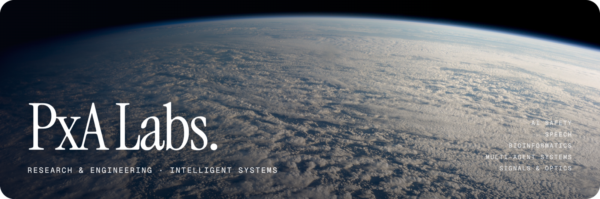
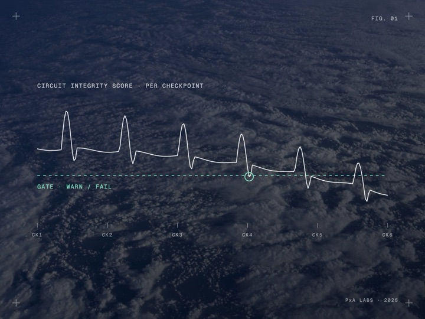
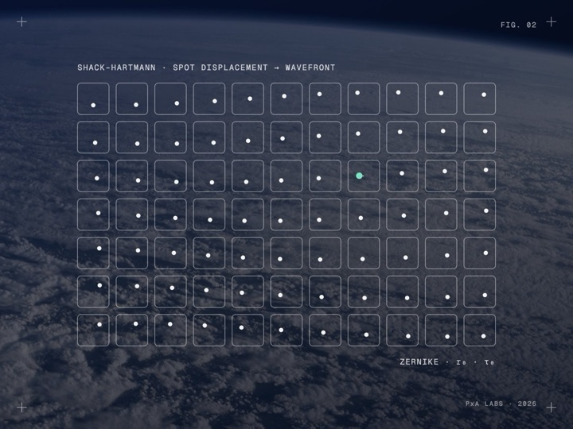
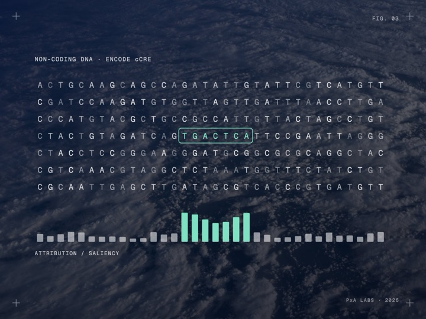
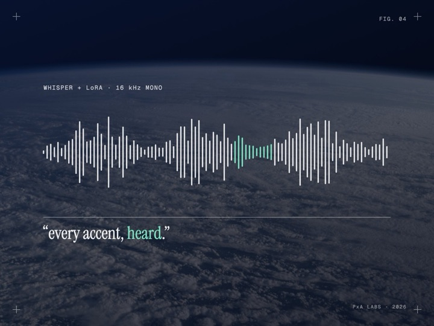
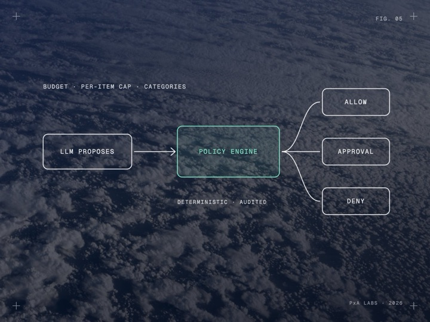
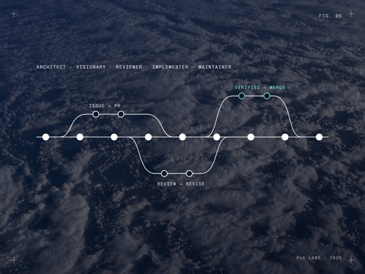
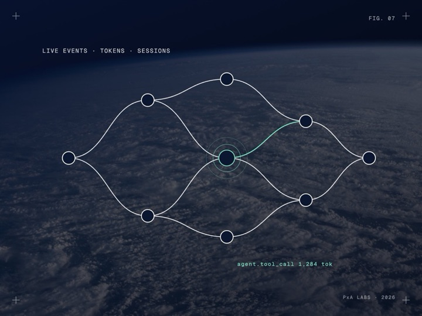
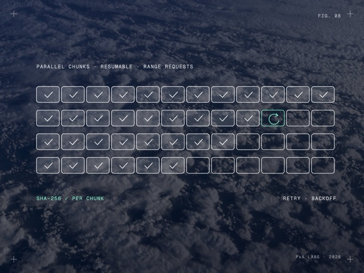
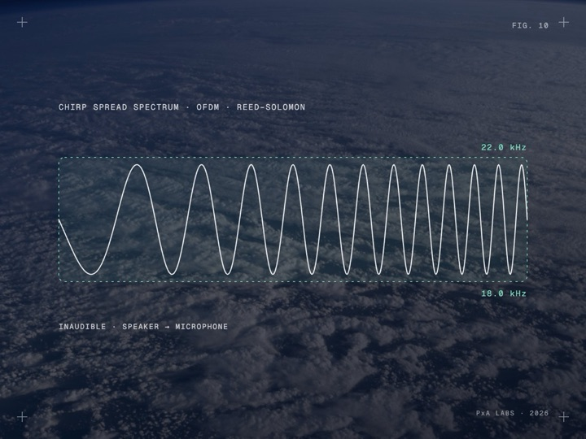

  

 

<b>PxA Labs.</b> A research collective building open, measurable intelligent systems, from safety monitors for fine-tuned LLMs and accent-robust speech recognition to interpretable genomics and real-time adaptive optics.

  <a href="#projects">Projects</a> &nbsp;/&nbsp;
  <a href="#research">Research</a> &nbsp;/&nbsp;
  <a href="#founders">Founders</a> &nbsp;/&nbsp;
  <a href="#collaborate">Collaborate</a>

 

## Projects

<code>9 OPEN-SOURCE SYSTEMS</code> &nbsp; Metrics are copied as stated in each repository.

<table>
<tr><td width="33%" valign="top"> <code>AI SAFETY · 2026 · HACKATHON</code> <a href="https://github.com/PxA-Labs/safetypulse"><b>SafetyPulse</b></a> A safety regression gate for LLM fine-tuning <b>14.3% → 25.2% on 119 HarmBench test prompts</b> · ASR rise from benign Alpaca tuning</td><td width="33%" valign="top"> <code>OPTICS · 2026 · HACKATHON</code> <a href="https://github.com/PxA-Labs/Project-RIPRA"><b>Project RIPRA</b></a> Real-time wavefront reconstruction from Shack-Hartmann sensor data <b>761 µs</b> · Hot-path latency per frame</td><td width="33%" valign="top"> <code>BIOINFORMATICS · 2026</code> <a href="https://github.com/PxA-Labs/interpretable-regulatory-genomics"><b>Interpretable Regulatory Genomics</b></a> Interpretable ML to discover regulatory switches in non-coding DNA <b>0.8830</b> · XGBoost (k=4 k-mers) test AUROC</td></tr>
<tr><td width="33%" valign="top"> <code>SPEECH · 2026</code> <a href="https://github.com/PxA-Labs/IndiVoice-DeepASR"><b>IndiVoice-DeepASR</b></a> Bridging the accent gap in ASR with Whisper + LoRA</td><td width="33%" valign="top"> <code>AI SAFETY · 2026 · HACKATHON</code> <a href="https://github.com/PxA-Labs/Mandate"><b>Mandate</b></a> Spending guardrails for AI agents: the LLM proposes, code decides</td><td width="33%" valign="top"> <code>DEVELOPER TOOLS · 2026</code> <a href="https://github.com/PxA-Labs/AutoMaintainer"><b>AutoMaintainer</b></a> An always-on autonomous AI software engineering team</td></tr>
<tr><td width="33%" valign="top"> <code>MULTI-AGENT SYSTEMS · 2026</code> <a href="https://github.com/PxA-Labs/AgentsScope"><b>AgentScope</b></a> Lightweight, self-hosted observability for multi-agent AI pipelines</td><td width="33%" valign="top"> <code>SYSTEMS · 2026</code> <a href="https://github.com/PxA-Labs/ReliaDL"><b>ReliaDL</b></a> Production-grade resilient parallel download engine for data pipelines</td><td width="33%" valign="top"> <code>SIGNAL PROCESSING · 2026</code> <a href="https://github.com/PxA-Labs/ultrasonic-phy-layer"><b>Soundwave</b></a> Transmitting digital data between nearby devices using ultrasonic audio <b>18.0 kHz to 22.0 kHz</b> · Target band</td></tr>
</table>

## Research

| | Domain | What we work on |
|---|---|---|
| `01` | **AI Safety & Alignment** | Monitoring and enforcing safe behaviour in models and agents, from refusal circuits to deterministic policy engines. |
| `02` | **Language & Speech** | ASR that closes regional accent gaps for Indian-accented speech. |
| `03` | **Bioinformatics** | Interpretable ML that decodes regulatory signals in non-coding DNA on modest, reproducible compute. |
| `04` | **Multi-Agent Systems** | Agent teams that act inside real tooling, with observability and runtime validation built in. |
| `05` | **Signals, Optics & Systems** | Real-time adaptive optics, acoustic physical layers and fault-tolerant data infrastructure. |

## How we work

**Honest baselines.** Every claim is measured against a fair baseline and reported as-is, including what did not work. 
**Real compute budgets.** We design for the hardware people have: Kaggle T4s, Colab, consumer speakers. 
**Open by default.** Code, notebooks and models are published so others can reproduce, audit and extend them. 
**Systems, not demos.** Checkpointing, observability, audit trails and fault tolerance from day one.

## Founders

<table>
<tr>
<td align="center" width="50%"> <b>Purvansh Joshi</b> <code>CO-FOUNDER</code> <a href="https://github.com/purvanshjoshi">GitHub</a> &nbsp;/&nbsp; <a href="https://www.linkedin.com/in/purvansh-joshi/">LinkedIn</a></td><td align="center" width="50%"> <b>Archit Mittal</b> <code>CO-FOUNDER</code> <a href="https://github.com/archittmittal">GitHub</a> &nbsp;/&nbsp; <a href="https://www.linkedin.com/in/archittmittal/">LinkedIn</a></td>
</tr>
</table>

## Collaborate

We welcome research collaborations with universities, open-source developers and AI safety groups.

**Email** &nbsp; [pxalabs@gmail.com](mailto:pxalabs@gmail.com) &nbsp;&nbsp; **Discord** &nbsp; [Join the server](https://discord.gg/W4BQ8835tk) &nbsp;&nbsp; **Hugging Face** &nbsp; [purvansh01](https://huggingface.co/purvansh01)

 

<code>PxA LABS · INDIA · ACTIVE RESEARCH</code>

